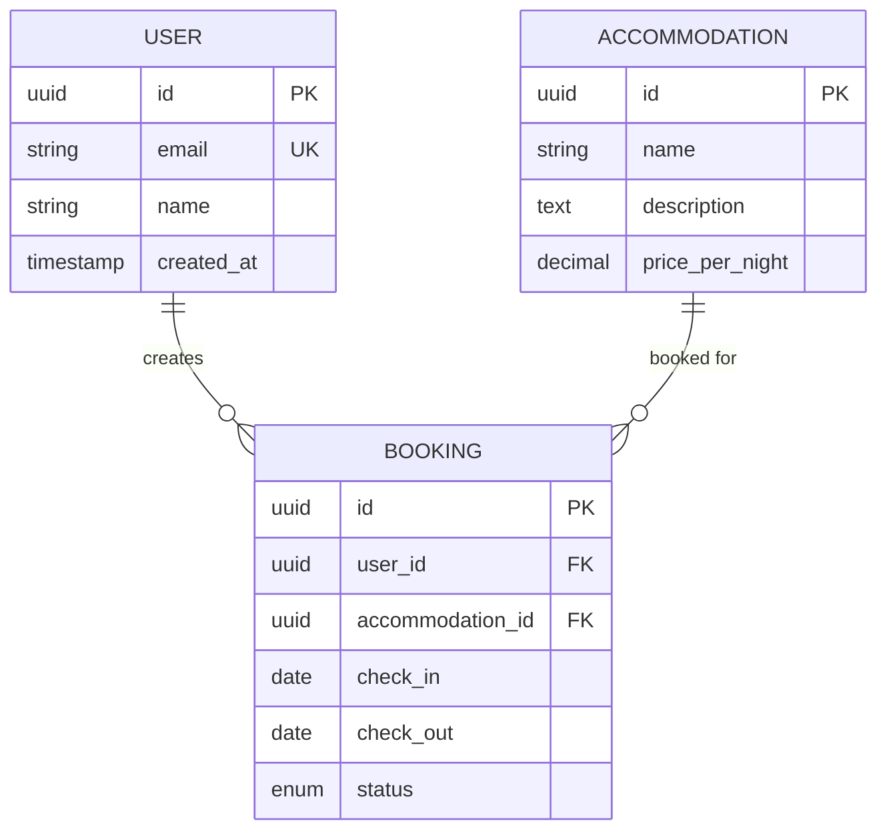
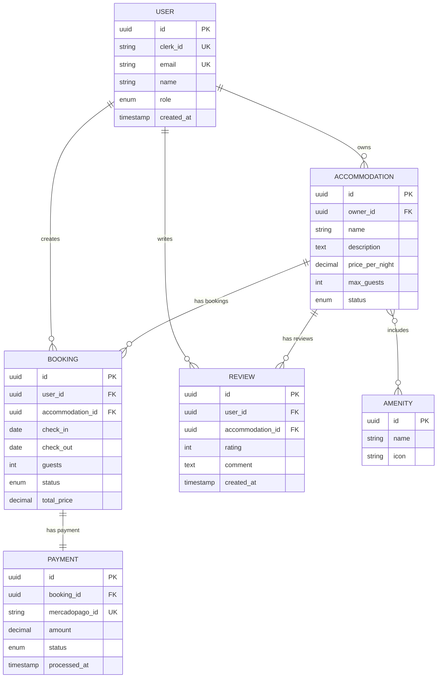
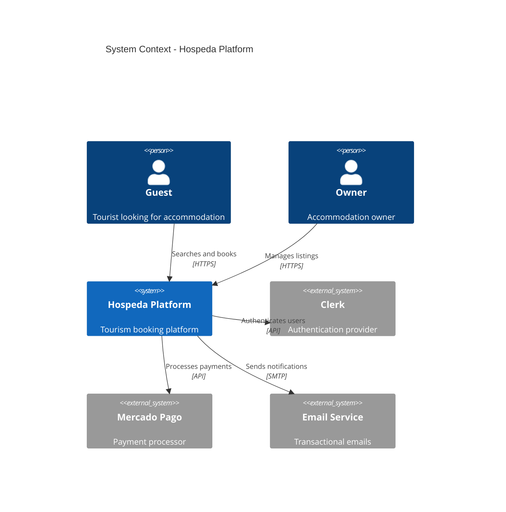
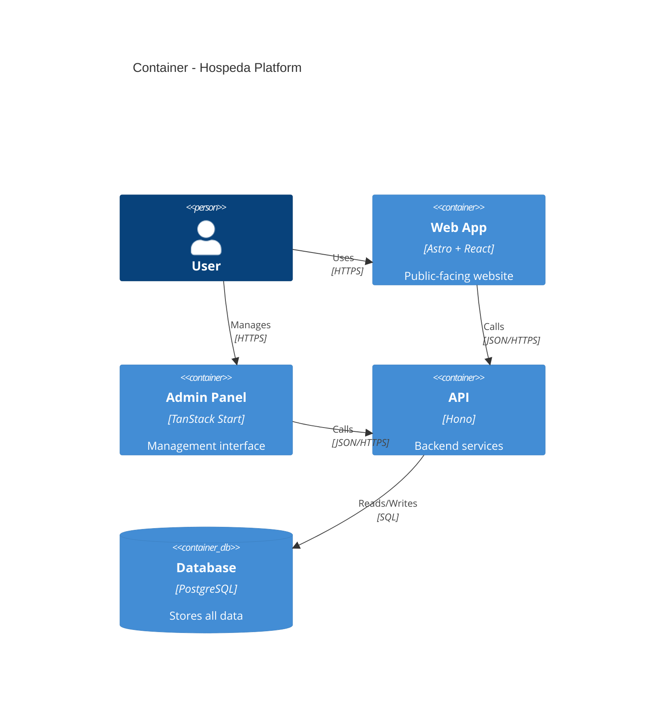
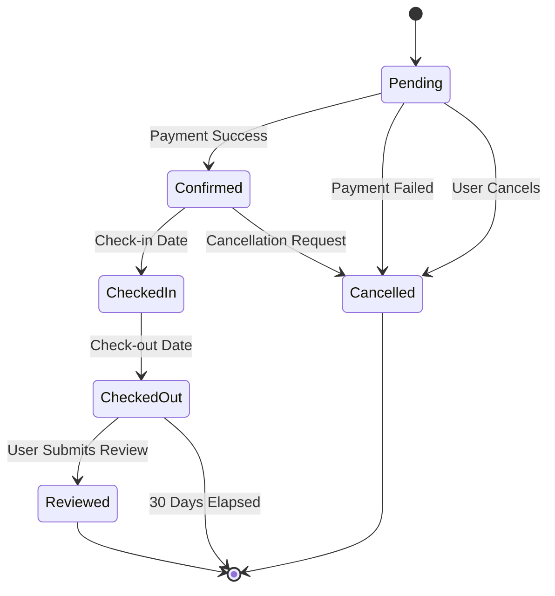
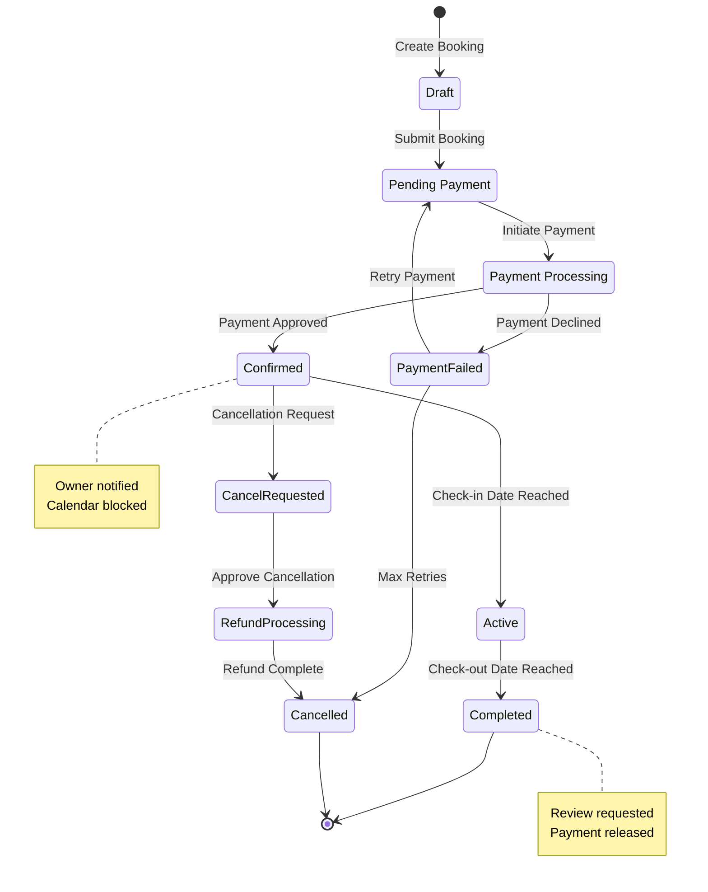

# Data, architecture and state diagrams

### Step 4: ERD Creation

**Objective**: Document database schema and relationships

**Syntax:**



**Relationship Types:**

- `||--||` - One to one
- `||--o{` - One to many
- `}o--o{` - Many to many
- `||--o|` - One to zero or one

**Cardinality Symbols:**

- `||` - Exactly one
- `o|` - Zero or one
- `}o` - Zero or more
- `}|` - One or more

**Example - Full Hospeda ERD:**



**Validation:**

- [ ] All entities defined
- [ ] Relationships accurate
- [ ] Cardinality correct
- [ ] Primary/Foreign keys marked

**Output**: ERD diagram

### Step 5: C4 Architecture Diagrams

**Objective**: Document system architecture at different levels

**Context Level** (System in environment):



**Container Level** (Applications and data stores):



**Component Level** (Internal structure):

```mermaid
C4Component
    title Components - API Application

    Container(api, "API", "Hono")

    Component(routes, "Routes", "Hono Router", "HTTP endpoints")
    Component(services, "Services", "Business Logic", "Domain operations")
    Component(models, "Models", "Data Access", "DB operations")
    Component(middleware, "Middleware", "Cross-cutting", "Auth, logging, errors")

    Rel(routes, middleware, "Uses")
    Rel(routes, services, "Calls")
    Rel(services, models, "Uses")
    Rel(models, db, "Queries")
```

**Validation:**

- [ ] Appropriate level selected
- [ ] All systems/containers shown
- [ ] Relationships clear
- [ ] External systems identified

**Output**: C4 architecture diagrams

### Step 6: State Diagram Creation

**Objective**: Document state machines and lifecycles

**Syntax:**



**Example - Booking Lifecycle:**



**Validation:**

- [ ] All states defined
- [ ] Transitions logical
- [ ] Start/end states marked
- [ ] Notes explain key states

**Output**: State diagram
